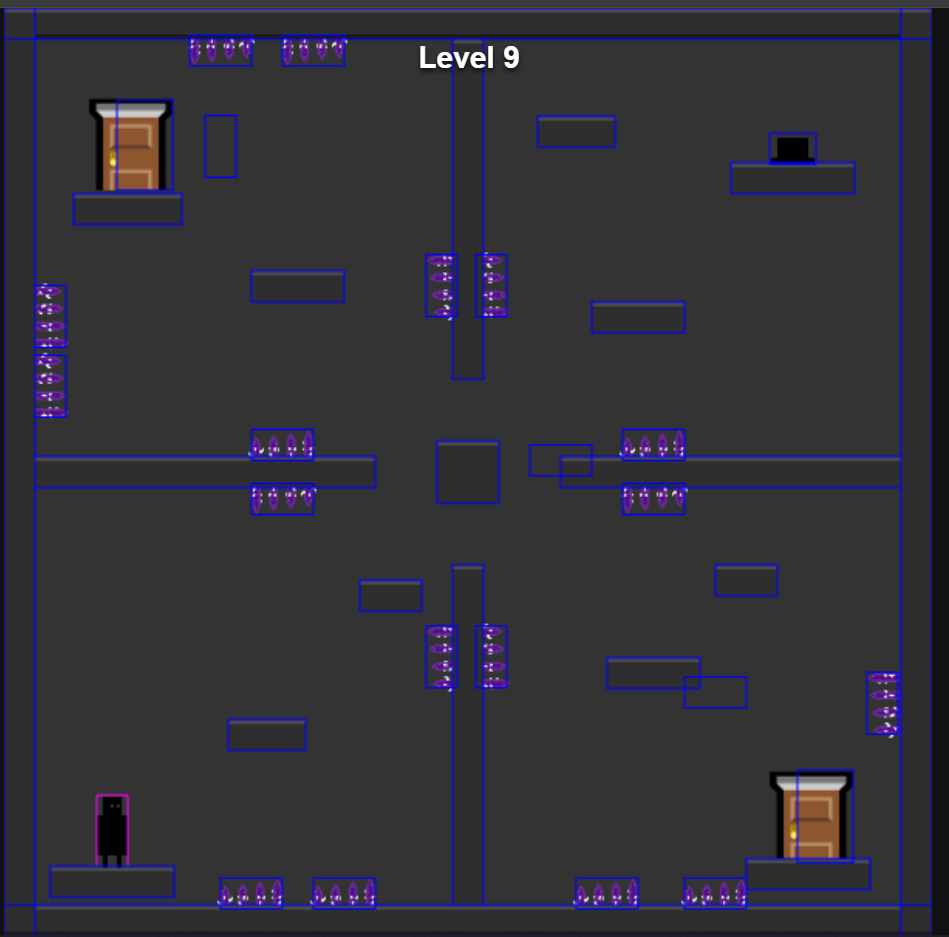

<div align="center">

# 👹 DEVIL ROTATE 🔄
### *2D Gravity-Rotation Puzzle Platformer*

<br/>

### 🚀 Quick Play & Download Links

[](https://sachin35544.github.io/Devil-Rotate/)
[](https://github.com/sachin35544/Devil-Rotate/releases/latest/download/DevilRotate.apk)
[](https://github.com/sachin35544/Devil-Rotate/releases)

| Platform | Link | Description |
|:---|:---|:---|
| 🌐 **Live Web (PC & Mobile)** | **[sachin35544.github.io/Devil-Rotate](https://sachin35544.github.io/Devil-Rotate/)** | Play instantly in any web browser |
| 📱 **Android APK Download** | **[Download DevilRotate.apk](https://github.com/sachin35544/Devil-Rotate/releases/latest/download/DevilRotate.apk)** | Direct APK download for Android phones |

<br/>

---

</div>

## 📸 Screenshots

<div align="center">

| Level 9: 360° Gravity Maze | Level 10: Boss Gauntlet | Mobile D-Pad Controls |
|:---:|:---:|:---:|
|  |  |  |

</div>

---

## 🎮 Game Features

- 🔄 **360° World Rotation**: Rotate by 90° increments to dynamically shift gravity. Ceilings become floors, and walls become pathways (`Q` / `E` or touch buttons).
- 🎯 **10 Handcrafted Levels**: Features invisible spikes, 200ms crumbling platforms, proximity ambush traps, and deceptive fake doors.
- 📱 **Mobile APK Ready**: Engineered with a **130ms tap-step buffer** and safe margins to prevent Android back-gesture conflicts.
- 🔊 **Dynamic Audio**: Retro sound effects for jumps, rotations, breaking blocks, victories, clicks, and deaths.
- 💾 **Progress Auto-Save**: Your unlocked levels are automatically saved locally in your browser.

---

## 🕹️ Controls

| Action | Keyboard | Mobile Touch |
|:---|:---:|:---:|
| **Move Left / Right** | <kbd>A</kbd> / <kbd>D</kbd> or <kbd>←</kbd> / <kbd>→</kbd> | `←` / `→` (Tap = 1 Step, Hold = Run) |
| **Jump** | <kbd>W</kbd> / <kbd>↑</kbd> / <kbd>Space</kbd> | `↑` (W / SPACE) |
| **Rotate World** | <kbd>Q</kbd> (Left) / <kbd>E</kbd> (Right) | `↺` / `↻` |
| **Enter Door / Button** | <kbd>S</kbd> / <kbd>↓</kbd> / <kbd>Enter</kbd> | `↓` (S / ENTER) |
| **Pause Menu** | <kbd>Esc</kbd> / <kbd>P</kbd> | `❚❚` Menu Button |

---

## 📦 How to Upload & Host the APK (Developer Guide)

To upload a new APK so users can download it directly from GitHub:
1. Go to: **[GitHub Releases / New](https://github.com/sachin35544/Devil-Rotate/releases/new)**
2. Enter tag: `v1.0.0` and click **Create new tag**.
3. Set title: `Devil Rotate v1.0.0 APK`.
4. Drag and drop your `DevilRotate.apk` file into the **"Attach binaries"** box.
5. Click **Publish release**. The download link at the top of this page will immediately provide the file to users!

---

## 💻 Run Locally

```bash
# Clone repository
git clone https://github.com/sachin35544/Devil-Rotate.git
cd Devil-Rotate

# Start a local web server (Python)
python -m http.server 5500
# Then open http://localhost:5500 in your browser
```

---

<div align="center">

Developed with ❤️ by **[Sachin Kumawat](https://github.com/sachin35544)** • Built with **[Phaser 3.55.2](https://phaser.io/)** • Released under the **[MIT License](LICENSE)**

</div>
