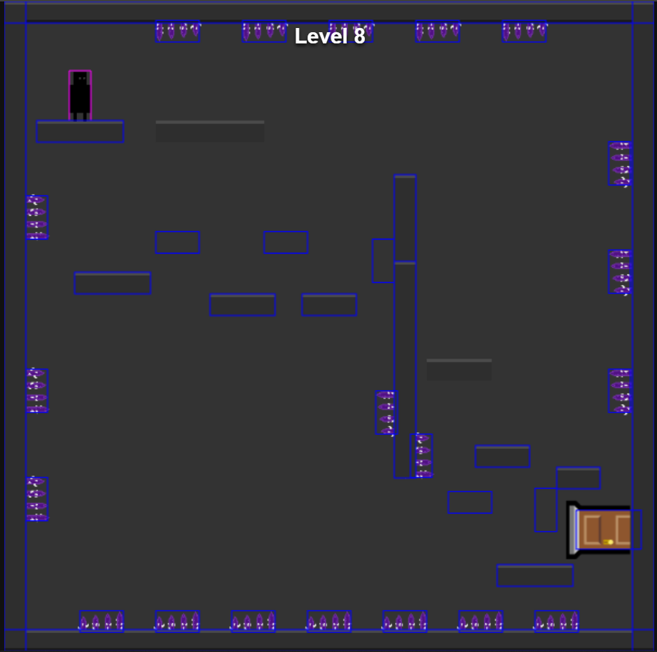
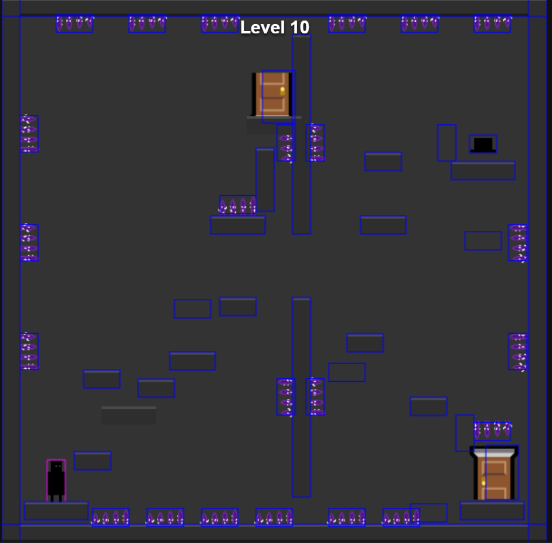

<div align="center">

# 👹 DEVIL ROTATE 🔄
### *A Mind-Bending 2D Gravity-Rotation Puzzle Platformer*

[](https://sachin35544.github.io/Devil-Rotate/)
[](https://github.com/sachin35544/Devil-Rotate/releases)
[](https://phaser.io/)
[](LICENSE)

<br/>

> **"Rotate the world, shift gravity, dodge devilish troll traps, and escape the labyrinth!"**

<p align="center">
  <a href="https://sachin35544.github.io/Devil-Rotate/">
    
  </a>
</p>

</div>

---

## 📑 Table of Contents
1. [🎮 About The Game](#-about-the-game)
2. [✨ Key Features](#-key-features)
3. [📸 Gameplay Screenshots](#-gameplay-screenshots)
4. [🕹️ Controls (Keyboard & Touch)](#️-controls-keyboard--touch)
5. [💀 Obstacles & Troll Mechanics](#-obstacles--troll-mechanics)
6. [🗺️ Level Progression](#️-level-progression)
7. [📱 Android APK & Download Guide](#-android-apk--download-guide)
8. [🛠️ Tech Stack & Architecture](#️-tech-stack--architecture)
9. [💻 Local Installation & Setup](#-local-installation--setup)
10. [📜 License & Credits](#-license--credits)

---

## 🎮 About The Game

**Devil Rotate** is an adrenaline-pumping 2D puzzle platformer built with **Phaser 3.55.2** and pure JavaScript. The entire room can rotate in 90-degree increments (0°, 90°, 180°, 270°), instantly rewriting the laws of physics. Ceiling becomes floor, walls become ceilings, and gravity alters in real-time vector coordinates!

Behind its minimalist dark aesthetic lies a cunning **Troll Game Engine** inspired by legendary rage-platformers (*Trap Adventure*, *I Wanna Be The Guy*, *Syobon Action*). Nothing is what it seems:
- Ceilings hold hidden spikes.
- Seemingly safe platforms vanish into thin air.
- Doors turn out to be deathtraps until hidden switches transform them into real exits!

---

## ✨ Key Features

- 🔄 **360° Dynamic Gravity Rotation**: Smooth camera rotation tweens dynamically readjust player hitbox offsets, floor-collision detection, and 4-way gravity vector physics (`{x, y}`).
- 🎯 **10 Handcrafted Escalating Levels**: From basic gravity orientation to the brutal **Level 10 Boss Gauntlet**.
- 🎛️ **Dual Input Ecosystem**:
  - **Desktop Keyboard**: Full support for `WASD`, `Arrow Keys`, `Space`, `Q`/`E`, `Enter`, `Esc`/`P`, and `H`.
  - **Mobile Touch D-Pad**: High-precision virtual controls featuring an engineered **130ms Tap-Step Buffer** and Android edge-navigation safe margins.
- 💥 **10+ Troll & Puzzle Obstacles**:
  - Disintegrating crumble blocks (fast 200ms collapse)
  - Proximity-triggered sudden spikes & falling walls
  - Invisible ghost blocks & troll walls
  - Fake death doors & boss trigger buttons
- 🔊 **Dynamic Audio Engine**: Custom sound effects for jumps, world rotations, platform breaks, victory chimes, menu clicks, and death splats.
- 💾 **Persistent Progress Saving**: Automatically unlocks and remembers completed levels in `localStorage`.
- 📱 **100% Cross-Platform Responsive**: Plays natively on Desktop, Laptop, Tablet, Mobile Browser, or compiled Android APK.

---

## 📸 Gameplay Screenshots

<div align="center">

| Level 8: Precision Spike Maze | Level 9: 360° Multi-Axis Gravity Maze |
|:---:|:---:|
|  |  |
| *Navigate through tight spike corridors with high-precision platforming.* | *Full 4-way gravity puzzle with hidden door triggers & lethal obstacles.* |

<br/>

| Level 10: The Boss Gauntlet | Adaptive Mobile Touch D-Pad |
|:---:|:---:|
|  |  |
| *The ultimate trial combining all 10 troll mechanics and fake door mind games.* | *Engineered with 130ms tap-step buffer & Android back-gesture safe zone.* |

</div>

---

## 🕹️ Controls (Keyboard & Touch)

The game provides seamless controls on both Desktop keyboards and Mobile touchscreens.

| Action | Keyboard Keys | Mobile Virtual Button | Description |
|:---|:---|:---:|:---|
| **Move Left** | <kbd>A</kbd> / <kbd>←</kbd> | `[ ← ]` (A) | Move player left along current floor |
| **Move Right** | <kbd>D</kbd> / <kbd>→</kbd> | `[ → ]` (D) | Move player right along current floor |
| **Jump** | <kbd>W</kbd> / <kbd>↑</kbd> / <kbd>Space</kbd> | `[ ↑ ]` (W / SPACE) | Jump against current gravity direction |
| **Rotate Counter-Clockwise** | <kbd>Q</kbd> | `[ ↺ ]` (Q) | Rotate world by -90° (Left) |
| **Rotate Clockwise** | <kbd>E</kbd> | `[ ↻ ]` (E) | Rotate world by +90° (Right) |
| **Enter Door / Activate Button** | <kbd>S</kbd> / <kbd>↓</kbd> / <kbd>↵ Enter</kbd> | `[ ↓ ]` (S / ENTER) | Enter victory door or trigger floor switch |
| **Pause / Resume** | <kbd>Esc</kbd> / <kbd>P</kbd> | `[ ❚❚ ]` Top Bar | Open pause menu (Resume, Restart, Home) |
| **Controls Help** | <kbd>H</kbd> / <kbd>?</kbd> | `[ ⌨️ Controls ]` Top Bar | Toggle keyboard shortcuts cheatsheet |
| **Debug Hitboxes** *(Dev)* | <kbd>F2</kbd> / <kbd>B</kbd> | — | Toggle Phaser Arcade physics bounding boxes |

> **💡 Mobile Pro-Tip**: Tapping the Left/Right button moves your character by exactly one calculated step (~26px), while holding it down keeps your character running at full speed without delay!

---

## 💀 Obstacles & Troll Mechanics

Devil Rotate features 10 distinct interactive mechanisms built directly into the game engine:

| # | Obstacle / Mechanism | In-Game Behavior |
|:---:|:---|:---|
| 1 | **Standard Platforms** | Solid dark-granite walls with light-edge highlights. Blocks player movement and supports gravity. |
| 2 | **Visible Spikes (`thorn`)** | Fatal hazard oriented in 4 directions (`dir`: 0 = Up, 1 = Right, 2 = Down, 3 = Left). Instant death on contact. |
| 3 | **Invisible Spikes** | Completely transparent spikes. Unsuspecting players walk into them unless they remember previous trap layouts! |
| 4 | **Troll Blocks** | Hidden in mid-air (`alpha: 0`). When the player bumps into them while jumping, they bounce and reveal themselves. |
| 5 | **Fake Visual Blocks** | Look identical to real platforms, but lack physics collision bodies. Stepping on them drops the player into the abyss! |
| 6 | **Crumbling Temp Blocks** | Step-sensitive platforms. When touched, they flash red and disintegrate in **200 milliseconds**. |
| 7 | **Interactive Floor Buttons** | Step-on switches that unlock secret passages, reveal hidden doors, or transform trap doors. |
| 8 | **Sudden Proximity Items** | Spikes or blocks that spawn out of thin air when the player gets within a certain distance or jumps. |
| 9 | **Fake Exit Doors (🚪)** | Deceptive doors that trigger instant death when touched! Designed to punish players who rush to escape. |
| 10 | **Transforming Gate (Boss)** | In Level 10, the initial door is fake. Pressing the boss button summons another fake door while converting the first door into the real exit! |

---

## 🗺️ Level Progression

- **Level 1 — Orientation**: Learn basic movement, single-axis jumping, and gravity flipping.
- **Level 2 — Inversion**: Platforming with inverted ceiling gravity and tight spike gaps.
- **Level 3 — The Unseen**: Introduction of invisible spikes and mid-air troll blocks.
- **Level 4 — Fragile Ground**: Fast-paced gauntlet featuring 200ms disintegrating crumbling platforms.
- **Level 5 — Mini-Boss**: High-precision rotation timing surrounded by multi-directional spike walls.
- **Level 6 — Sudden Ambush**: Proximity-triggered traps that appear right when you commit to a jump.
- **Level 7 — Illusions**: Real vs fake platform visual puzzles.
- **Level 8 — The Spike Labyrinth**: Multi-axis labyrinth requiring continuous gravity shifts.
- **Level 9 — 360° Gravity Maze**: A full circular puzzle chamber where a hidden switch permanently reveals the exit.
- **Level 10 — The Devil's Gauntlet (Boss)**: The ultimate rage challenge featuring all 10 engine mechanics, fake door psychological warfare, and the true Devil Rotate crown! 👑

---

## 📱 Android APK & Download Guide

You can play Devil Rotate directly in any modern mobile browser or install it as a standalone Android APK.

### 📥 1. Download Android APK
- Go to the [Releases Page](https://github.com/sachin35544/Devil-Rotate/releases).
- Download the latest `DevilRotate.apk`.
- Open the `.apk` on your Android device and tap **Install**. *(If prompted, enable "Install from Unknown Sources" in your Android settings)*.

---

### 📦 2. Developer Guide: How to Upload & Host Your APK on GitHub

Agar aap apni banayi hui APK ko GitHub par upload karna chahte hain taaki koi bhi user 1-click me download kar sake:

#### **Method 1: GitHub Releases (Recommended - Best Practice)**
1. Apne GitHub repository par jayein: `https://github.com/sachin35544/Devil-Rotate`.
2. Right sidebar me **Releases** par click karein (ya direct link: `https://github.com/sachin35544/Devil-Rotate/releases/new`).
3. **Draft a new release** par click karein.
4. **Choose a tag**: `v1.0.0` type karein aur *Create new tag* select karein.
5. **Release title**: `Devil Rotate v1.0.0 (Android APK)`.
6. Description me features likhein.
7. Niche **"Attach binaries by dropping them here or selecting them"** box me apni `DevilRotate.apk` file drag & drop kar dein.
8. **Publish release** button par click karein!
9. Ab aapka direct download link ready hai:
   ```text
   https://github.com/sachin35544/Devil-Rotate/releases/latest/download/DevilRotate.apk
   ```

#### **Method 2: Repository `release/` Folder**
Aap apni APK file ko seedhe project ke andar `release/DevilRotate.apk` folder me commit karke push kar sakte hain. User is link se direct download kar sakega:
```text
https://github.com/sachin35544/Devil-Rotate/raw/main/release/DevilRotate.apk
```

---

### 🔨 3. How to Build APK from this Source Code

Aap is HTML5 game se 5 minute me Android APK bana sakte hain:

#### **Option A: Using Website2APK / Web2App (Easiest)**
1. Website2APK Builder software open karein.
2. Select karein **Local HTML Website**.
3. Directory select karein: `d:\code\HTML Games\Devil Rotate`.
4. Orientation set karein: **Sensor Landscape** ya **Portrait**.
5. Click **Generate APK**!

#### **Option B: Using Capacitor (Modern & Production Ready)**
```bash
# 1. Initialize Capacitor
npm init @capacitor/app

# 2. Add Android Platform
npm install @capacitor/android
npx cap add android

# 3. Copy web assets to android
npx cap copy

# 4. Open Android Studio & Build APK
npx cap open android
```

---

## 🛠️ Tech Stack & Architecture

- **Game Engine**: [Phaser 3.55.2](https://phaser.io/) (Arcade Physics System)
- **Frontend / Scripting**: HTML5, Modern Vanilla JavaScript (ES6+), CSS3 Flexbox & Grid
- **Audio System**: Web Audio API / HTML5 Audio
- **Physics World**: Custom 4-way vector gravity with real-time dynamic body rotation offsets
- **Deployment**: GitHub Pages (Static Web Hosting)

### 📂 Directory Structure

```text
Devil Rotate/
├── assets/                  # Game sprites, audio, and visual assets
│   ├── button.png           # Interactive floor button spritesheet
│   ├── jump.png             # Player jump animation frames
│   ├── run.png              # Player run animation frames
│   ├── thorns.png           # Spike hazard spritesheet
│   └── sounds/              # Sound effects (jump, break, rotate, win, death, click)
├── screenshots/             # High-resolution gameplay screenshots
│   ├── level8_maze.png
│   ├── level9_gravity_maze.png
│   ├── level10_boss_gauntlet.png
│   ├── level10_layout.png
│   └── controls_dpad.png
├── index.html               # Main entry point & Phaser configuration
├── Levels.js                # Level coordinates, progression & obstacle definitions
├── Game_Item.js             # Entity factory (player, platforms, spikes, buttons, doors)
├── UI_Element.js            # HUD, on-screen D-Pad, pause menu, popups & CSS styling
├── Controls.js              # Movement physics, gravity calculations & input dispatchers
├── LICENSE                  # MIT License
└── README.md                # Project documentation & showcase
```

---

## 💻 Local Installation & Setup

Want to run the game locally on your computer?

1. **Clone the repository**:
   ```bash
   git clone https://github.com/sachin35544/Devil-Rotate.git
   cd Devil-Rotate
   ```

2. **Run a local web server**:
   Because Phaser loads external audio and spritesheets, run the game through a local HTTP server:

   - **Using VS Code Live Server**:
     Right-click `index.html` and select **"Open with Live Server"**.
   
   - **Using Python**:
     ```bash
     python -m http.server 5500
     ```
     Then open `http://localhost:5500` in your browser.

   - **Using Node / `npx serve`**:
     ```bash
     npx serve .
     ```

---

## 📜 License & Credits

- **Developer**: [Sachin Kumawat](https://github.com/sachin35544)
- **Engine**: [Phaser 3](https://phaser.io/) by Photon Storm
- **License**: Released under the [MIT License](LICENSE). Feel free to use, modify, and distribute with attribution!

<br/>

<div align="center">

**Enjoying the game? Give it a 🌟 on GitHub!**

[🎮 Play Game Now](https://sachin35544.github.io/Devil-Rotate/) • [🐛 Report a Bug](https://github.com/sachin35544/Devil-Rotate/issues) • [📱 Download APK](https://github.com/sachin35544/Devil-Rotate/releases)

</div>
