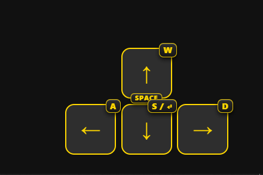

<div align="center">

# 👹 DEVIL ROTATE 🔄
### *2D Gravity-Rotation Puzzle Platformer*

<br/>

### 🚀 Quick Play & Test Links (सबसे ऊपर)

[](https://sachin35544.github.io/Devil-Rotate/)
[](https://github.com/sachin35544/Devil-Rotate/releases/latest/download/DevilRotate.apk)
[](https://github.com/sachin35544/Devil-Rotate/releases)

| Platform | Test Link | Description |
|:---|:---|:---|
| 🌐 **Live Web (PC & Mobile)** | **[sachin35544.github.io/Devil-Rotate](https://sachin35544.github.io/Devil-Rotate/)** | Browser me direct play karein |
| 📱 **Android APK Download** | **[Download DevilRotate.apk](https://github.com/sachin35544/Devil-Rotate/releases/latest/download/DevilRotate.apk)** | Mobile me install karke test karein |

<br/>

---

</div>

## 📸 Screenshots

<div align="center">

| Level 9: 360° Gravity Maze | Level 10: Boss Gauntlet | Mobile D-Pad Controls |
|:---:|:---:|:---:|
|  |  |  |

</div>

---

## 🎮 Game Features

- 🔄 **360° World Rotation**: 90° turn karte hi ceiling floor ban jati hai aur gravity vector dynamically badal jata hai (`Q` / `E` ya Touch Buttons).
- 🎯 **10 Troll Levels**: Invisible spikes, 200ms crumbling platforms, sudden drops aur fake doors.
- 📱 **Mobile APK Optimized**: 130ms Tap-Step buffer + Android edge-back gesture safe margin ke sath responsive touch controls.
- 🔊 **Full Audio FX**: Jump, rotate, break, win, death aur click sounds.
- 💾 **Auto-Save**: Level progress browser me auto-save hota hai.

---

## 🕹️ Controls

| Action | Keyboard | Mobile Touch |
|:---|:---:|:---:|
| **Move** | <kbd>A</kbd> / <kbd>D</kbd> or <kbd>←</kbd> / <kbd>→</kbd> | `←` / `→` (Tap = 1 Step, Hold = Run) |
| **Jump** | <kbd>W</kbd> / <kbd>↑</kbd> / <kbd>Space</kbd> | `↑` (W / SPACE) |
| **Rotate** | <kbd>Q</kbd> (Left) / <kbd>E</kbd> (Right) | `↺` / `↻` |
| **Enter / Button** | <kbd>S</kbd> / <kbd>↓</kbd> / <kbd>Enter</kbd> | `↓` (S / ENTER) |
| **Pause** | <kbd>Esc</kbd> / <kbd>P</kbd> | `❚❚` Menu |

---

## 📦 APK Kaise Dalein (Developer Guide)

Agar aapko nayi APK GitHub par upload karni hai:
1. Open karein: **[GitHub Releases / New](https://github.com/sachin35544/Devil-Rotate/releases/new)**
2. Tag me `v1.0.0` type karein aur Title me `Devil Rotate v1.0.0 APK`.
3. Apni `DevilRotate.apk` file ko **"Attach binaries"** wale box me drag & drop karein.
4. **Publish release** par click karein. Upar diye gaye download link se user direct download kar sakega!

---

## 💻 Run Locally

```bash
# Clone repository
git clone https://github.com/sachin35544/Devil-Rotate.git
cd Devil-Rotate

# Run with python local server
python -m http.server 5500
# Open http://localhost:5500 in browser
```

---

<div align="center">

Developed with ❤️ by **[Sachin Kumawat](https://github.com/sachin35544)** • Powered by **Phaser 3.55.2** • [MIT License](LICENSE)

</div>
